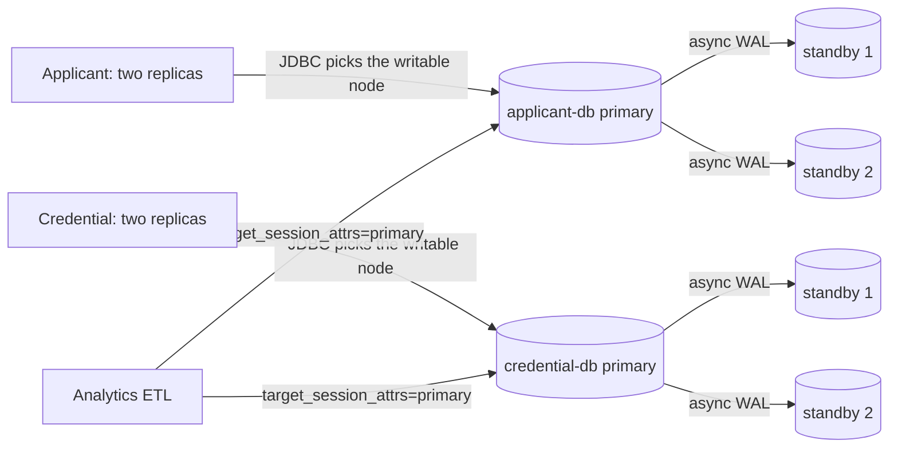

# Applicant and Credential database replication

Applicant and Credential each get one PostgreSQL 18 primary and two **asynchronous** physical standbys
(WAL streaming), the same design as Server Rules and University Record. Failover is scripted and manual, with
fencing. The nodes use the published `postgres:18` image with the public scripts in
`infrastructure/replication/postgres` mounted read-only: no custom database image and no private checkout.



Only the JDBC URL changes. Spring reads `SPRING_DATASOURCE_URL` before `spring.datasource.url`, so the
overlay sets it and the services run their published images unchanged
(`jdbc:postgresql://applicant-db:5432,applicant-db-standby-1:5432,applicant-db-standby-2:5432/applicant?targetServerType=primary&hostRecheckSeconds=1&...`).
The driver tries the three nodes and keeps the writable one, so after a promotion new connections go to the new
primary; Hikari drops the broken ones.

## What is different from Rules and University Record

The Applicant and Credential databases were **PostgreSQL 16 on Alpine**, a different major version and C library
from the PG18 image, so their data directory cannot be reused. The new primary has its own volume
(`applicant-db-primary`, `credential-db-primary`) and the data moves by dump and restore:

| Step | What happens |
|---|---|
| `prepare` | Dumps the running PG16 database and its roles to `infrastructure/backups/` (private, git-ignored) and records the row count of every table. Changes nothing. |
| `enable` | Stops the application, takes the **final** dump, stops the PG16 container, starts the PG18 primary from the overlay, restores roles and data, **compares the row count of every table with the original**, then starts both standbys (they copy the primary when they first start) and the application. Any mismatch stops it before the application starts. |

The legacy volumes `applicant-db-data` and `credential-db-data` are never mounted by the overlay, so they stay
as they were. A fresh installation (no legacy volume) skips the dump: `enable` starts the three nodes and the
application creates its schema with Flyway.

The analytics reader (`analytics_reader`) keeps its password, its column grants and its default read-only
setting through the move: they are in the roles dump and in the database dump.

## Configure

Add to the existing `.env` (see `.env.example`): `APPLICANT_REPLICATION_PASSWORD`,
`CREDENTIAL_REPLICATION_PASSWORD` (new, separate from the database passwords) and
`ANALYTICS_APPLICANT_HA_DSN`, `ANALYTICS_CREDENTIAL_HA_DSN` (the reader's DSN with the three hosts). Keep the
original `ANALYTICS_APPLICANT_DSN` and `ANALYTICS_CREDENTIAL_DSN`. Needs Compose 2.24.4 or newer and `jq`.

```dotenv
COMPOSE_FILE=docker-compose.yml:docker-compose.replication.yml
```

Keep that line once enabled, including after a failover. The HA DSNs use `target_session_attrs=primary`:
`read-write` would reject every node for the reader, because its role is read-only by default
(`default_transaction_read_only = on`), which libpq counts as not writable. The test below proves both.

## Move an existing deployment

Between game sessions, with the original databases running:

```bash
bash infrastructure/replication/cluster.sh applicant prepare
bash infrastructure/replication/cluster.sh applicant enable
bash infrastructure/replication/cluster.sh applicant status
bash infrastructure/replication/cluster.sh credential prepare
bash infrastructure/replication/cluster.sh credential enable
bash infrastructure/replication/cluster.sh credential status
docker compose up -d --no-deps analytics-scheduler     # picks up the HA DSNs
```

`status` shows one `PRIMARY` with two `streaming` / `async` standbys, and the same row counts. Check that both
application replicas are healthy in Service Discovery before sending traffic. Do not use `down -v`.

Rollback before relying on the new cluster: stop the new nodes and start the original with the base file only
(`docker compose -f docker-compose.yml up -d applicant-db applicant-service`). Writes made after `enable` are not
in the old volume, so this is only for a failed move.

## Failover and rejoining

```bash
bash infrastructure/replication/cluster.sh applicant failover applicant-db
bash infrastructure/replication/cluster.sh applicant status
bash infrastructure/replication/cluster.sh applicant rejoin applicant-db
```

Use the current primary's name after a later failover; `--candidate NODE` is accepted only if that node is not
behind the other available standby. The script stops the old primary, checks that restart is disabled, writes a
persistent `FENCED` marker (the start script refuses to run PostgreSQL while it exists), waits for each standby to
replay all the WAL it received, checks the database system identifiers, and promotes the most advanced standby. The
other standby is repointed to it. `rejoin` rebuilds a node as a standby from the new primary, keeps its previous
data directory under a timestamped name, and clears the fence only after the new base backup succeeded.

Same limits as the other clusters: asynchronous replication can lose writes that no available standby received;
timeline ancestry is not validated; fencing protects containers on this Docker host only; requests in flight during
the switch can fail and must be retried.

## Verify

```bash
bash tests/verify-applicant-credential-replication.sh              # both clusters
bash tests/verify-applicant-credential-replication.sh applicant    # one of them
```

It uses its own Compose project and a temporary copy of the files, so it does not touch a running CPR stack. For
each cluster it checks: the original database is PG16 and the application writes to it; `prepare` and `enable`
keep every row; the primary is PG18 with two streaming standbys holding the rows; a standby refuses writes; the
service reads and writes through the multi-host URL; the analytics reader reads the primary through the
`primary` DSN and is refused by `read-write`; after `failover` the old primary stays down on restart, the
application reconnects on its own and the earlier rows plus a new write are there; `rejoin` brings back one
primary and two streaming standbys with identical data.

`node tests/verify-replication-config.mjs` checks the merged Compose configuration without Docker Engine.
