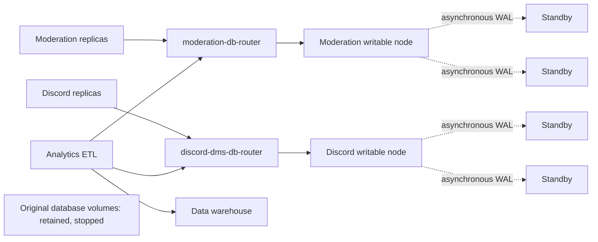

# Moderation and Discord database replication in CPR

This opt-in integration covers Daniela's two private services. Each database has one primary and two asynchronous PostgreSQL 16 standbys with separate persistent volumes. It does not change the other six database topologies.

The ordinary `docker-compose.yml` remains the original deployment. `docker-compose.replication.yml` redirects both applications and their analytics readers to stable TCP proxies and adds the new database nodes and migration jobs. The original volumes remain available for rollback. Compose **2.24.4 or newer** is required for `!override` dependency replacement.



After promotion, the proxy's writer changes; application and ETL hostnames remain unchanged. Internal networks give each cluster its own `db-1`, `db-2`, `db-3` aliases. Database nodes are not published to the host. The failover algorithm follows the private implementations: persistent fencing, conservative identity/timeline checks, durable WAL comparison, replay waiting, explicit promotion and verified rebuilding.

## 1. Publish and pin releases first

Each private repository's existing release workflow now publishes two images with the same version:

- `dannacojocari/moderation-service` and `dannacojocari/moderation-postgres`
- `dannacojocari/discord-dms-service` and `dannacojocari/discord-dms-postgres`

Use the normal feature → dev → main → release tag process. Both image pushes must succeed; a successful application push alone does not prove the database image was published. Verify amd64 and arm64 manifests. Use explicit released tags or digests in CPR, never `latest` for cutover.

Update the two CPR service submodule pins to the corresponding release commits. Deployment uses published images, so teammates do not need access to private source repositories to run it. The source pins document which release is deployed. The CPR scripts do not execute files from those private submodules.

In the existing CPR `.env`, fill:

```dotenv
MODERATION_REPLICATION_APP_IMAGE=dannacojocari/moderation-service:<released-tag>
MODERATION_DATABASE_IMAGE=dannacojocari/moderation-postgres:<released-tag>
DISCORD_DMS_REPLICATION_APP_IMAGE=dannacojocari/discord-dms-service:<released-tag>
DISCORD_DMS_DATABASE_IMAGE=dannacojocari/discord-dms-postgres:<released-tag>
MODERATION_REPLICATION_PASSWORD=<new-strong-password>
DISCORD_DMS_REPLICATION_PASSWORD=<different-new-strong-password>
```

Keep the existing database usernames/passwords and original analytics DSNs unchanged. Set `ANALYTICS_MODERATION_REPLICATION_DSN` and `ANALYTICS_DISCORD_REPLICATION_DSN` by copying the existing reader DSNs and changing **only** their hosts to `moderation-db-router` and `discord-dms-db-router`. Preserve percent encoding and use the existing restricted reader passwords, not owner credentials.

Default Compose project: `pad-team-17`. If your existing CPR stack uses another project name, export `CPR_PROJECT_NAME` with that exact name before every command. `CPR_ENV_FILE` selects an alternative environment file. Do not use a different project name for the live cutover: it would refer to different source containers and volumes.

## 2. Rehearse with disposable data

Requires Node.js 24 and Docker; no npm dependencies or private source checkouts are required. Initialize `services/analytics` because the fixture uses its reader setup scripts.

Set these four environment variables to the release images to test:

```sh
export TEST_MODERATION_APP_IMAGE=dannacojocari/moderation-service:<released-tag>
export TEST_MODERATION_DATABASE_IMAGE=dannacojocari/moderation-postgres:<released-tag>
export TEST_DISCORD_APP_IMAGE=dannacojocari/discord-dms-service:<released-tag>
export TEST_DISCORD_DATABASE_IMAGE=dannacojocari/discord-dms-postgres:<released-tag>
docker pull "$TEST_MODERATION_APP_IMAGE"
docker pull "$TEST_MODERATION_DATABASE_IMAGE"
docker pull "$TEST_DISCORD_APP_IMAGE"
docker pull "$TEST_DISCORD_DATABASE_IMAGE"
node tests/verify-replication-integration.mjs
TEST_ROLLBACK_ONLY=1 node tests/verify-replication-integration.mjs
```

The test renders CPR configuration into a unique `pad17-repl-test-*` project, removes fixed container names/ports in that fixture only, and uses new volumes and random credentials. It exercises backup/restore, exact table-record fingerprints, role membership/password preservation, column-restricted ETL access, migrations, application reads/reconnection, Discord writes, ETL after both promotions, fencing, standby rebuilding and rollback guards. Only its own resources are removed.

The selective ETL runs are real. Six unrelated source databases and the continuously running all-source scheduler are not exercised in this fixture; full team and scheduler checks remain part of live acceptance. The separate rollback test proves the original databases resume before activation and a rolled-back snapshot cannot later be reused silently.

The manual GitHub workflow **Verify private database replication** runs the same tests against four explicit released images. Before release, local verification can use locally built equivalents, but that does not replace a final test of pulled release images.

## 3. Take the final backup during a maintenance window

Make sure there are no other clients writing directly to these two databases. The script stops both application services and analytics, compares source data before/after each dump, and then stops the original databases. Do not restart them during migration.

```sh
bash scripts/replication-cutover.sh backup
```

The command prints the absolute backup directory. Store a copy outside the working tree if needed. `.replication-backups/` contains database records and password hashes; files are created with restrictive permissions and are gitignored. Do not commit or share them.

The backups include custom-format PostgreSQL dumps, replayable role/password/membership/database-setting SQL, table-record fingerprints and SHA-256 checksums. Existing analytics-reader column grants and default read-only settings are preserved. A source role named `replicator` is rejected because that name is reserved for the new replication account.

Failure leaves the writers stopped for inspection; it does not silently resume writes or delete anything.

## 4. Restore into new volumes, verify, then activate

Use the exact path printed by `backup`:

```sh
bash scripts/replication-cutover.sh restore /absolute/path/to/completed-backup
bash scripts/replication-cutover.sh verify
bash scripts/replication-cutover.sh activate
```

Restore refuses nonempty target databases. It checks backup checksums, restores roles and database contents transactionally, compares every public table's records, creates both standbys, and runs the versioned baseline migrations on the writer. Matching existing schemas are adopted; incompatible schemas are rejected.

`verify` checks the recorded writer identity, both standby receivers and replay progress, then runs real reconciliation ETL through the proxies using the preserved reader credentials. It must succeed before activation. The existing analytics warehouse must be available.

`activate` recreates only the two application services and the analytics scheduler with the overlay. It does not start the entire team stack or all its dependencies. Keep the existing broker, Discovery, Redis and other required services running. Check both application replicas, Gateway/Discord access, a representative game flow and `analytics-scheduler` logs afterward.

Once activated, manage the stack with the overlay. Do **not** run a plain base-only `docker compose up` to recreate these services: that configuration still targets the original databases. For inspection:

```sh
export REPLICATION_STATE_ROOT="$PWD/.replication/${CPR_PROJECT_NAME:-pad-team-17}"
docker compose --env-file "${CPR_ENV_FILE:-.env}" -p "${CPR_PROJECT_NAME:-pad-team-17}" -f docker-compose.yml -f docker-compose.replication.yml ps
docker compose --env-file "${CPR_ENV_FILE:-.env}" -p "${CPR_PROJECT_NAME:-pad-team-17}" -f docker-compose.yml -f docker-compose.replication.yml logs --tail 40 analytics-scheduler
```

Avoid `down --volumes`: the model includes both original and replicated persistent storage. Route/identity files in `.replication/<project>/` must remain paired with their volumes.

## 5. Failover and rejoining

Commands operate on one pair only:

```sh
bash scripts/database-replication.sh moderation status
bash scripts/database-replication.sh moderation failover
bash scripts/database-replication.sh discord-dms status
bash scripts/database-replication.sh discord-dms failover
```

An optional candidate can be supplied, for example `failover db-2`. A less advanced available candidate is rejected. The script fences/stops the current primary even when a later candidate check rejects promotion, so resolve the error and retry; never remove a fence to bring an old writer back.

After promotion to `db-2`, restore redundancy:

```sh
bash scripts/database-replication.sh moderation rejoin db-1 --rebuild
bash scripts/database-replication.sh moderation rejoin db-3 --rebuild
bash scripts/database-replication.sh moderation verify
```

Use `discord-dms` for the other pair and adjust node names if a different node was promoted. Rebuild retains the old data directory under `previous-<timestamp>` inside its volume; it never merges divergent writes. Inspect retained directories before manually freeing disk space.

If promotion/routing was interrupted with a pending state file, inspect the cluster and use `complete`. Stale operation locks require confirming no command is running before removing the empty lock directory. Cutover and failover commands exclude each other; do not bypass their locks.

To verify ETL after failover without starting dependent databases:

```sh
export REPLICATION_STATE_ROOT="$PWD/.replication/${CPR_PROJECT_NAME:-pad-team-17}"
docker compose --env-file "${CPR_ENV_FILE:-.env}" -p "${CPR_PROJECT_NAME:-pad-team-17}" -f docker-compose.yml -f docker-compose.replication.yml run --rm --no-deps analytics-etl --mode reconcile --source moderation-service --source discord-dms-service
```

Applications keep their existing database host. Existing requests may fail during the manual switch; ambiguous writes are not automatically retried. The scheduler retries failed loads on its next configured run, and the explicit command above provides immediate verification.

## Rollback boundaries

Before activation, with no new application writes admitted:

```sh
bash scripts/replication-cutover.sh rollback-before-activation
```

This stops new cluster nodes and resumes the original deployment. It retains all new volumes and backups. A `rolled-back` marker blocks reuse of those snapshots after writes resume on the originals. A new attempt requires reviewing/resetting **only the new replica volumes and routing state**, then taking a fresh backup; never delete the original volumes as cleanup.

After activation, the script refuses this rollback. Returning to stale original volumes would lose new writes. A reverse migration requires another maintenance window, fresh backups of the current primaries and a reviewed restore procedure. The activation marker is written before starting writers, so even a partial startup is treated conservatively.

## Limits

Replication is asynchronous and can lose acknowledged writes that never reached an available standby. Unavailable nodes cannot be compared. Fencing protects guarded containers on this Docker host; a privileged operator can bypass it. One host and one proxy per pair remain failure domains. Database copies do not replace backups. Old legacy volumes are retained and stopped, not automatically reconciled with subsequent writes.

References: [Compose merge rules](https://docs.docker.com/reference/compose-file/merge/), [PostgreSQL restore](https://www.postgresql.org/docs/16/app-pgrestore.html), [PostgreSQL failover](https://www.postgresql.org/docs/16/warm-standby-failover.html).
