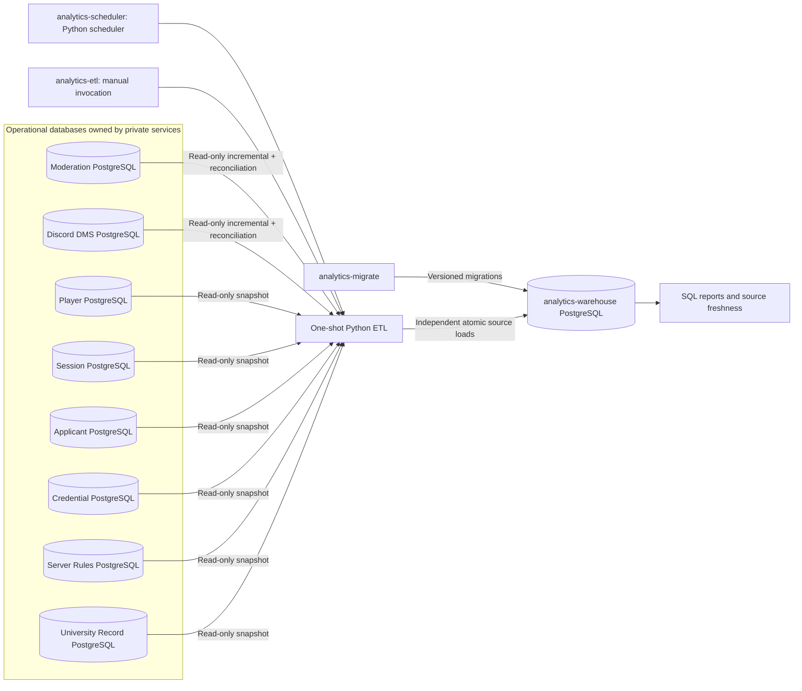

# Data warehouse and ETL (Lab 5, Grade 4)

## Deployment and release status

Analytics is implemented in [pad-team-17-analytics](https://github.com/DannaCojocari/pad-team-17-analytics).
CPR deploys `dannacojocari/pad-team-17-analytics` as a published image; it does not
build from the source submodule. `ANALYTICS_IMAGE` selects the image release.
The analytics Git release `v0.1.0` is on main at commit
`8251a5c408eb01c8f99be47b2cb21fb4a8c52457`.

Track that source revision in `services/analytics`, following the existing CPR
submodule convention. Teammates who need source access can initialize it with:

```sh
git submodule update --init services/analytics
```

The recorded gitlink pins the reviewed source; the Docker image supplies runtime
code. Updating one does not update the other. Keep both aligned for each release.
The existing publishing convention can republish a Docker version tag on later
main pushes, so inspect the OCI revision label and use a verified digest when an
exact artifact must remain pinned. Do not move the Git release tag.

The Git release has been verified. Docker Hub publication and the final pull-based
acceptance check remain separate: a Git tag or local-image test does not prove
registry publication or both platform manifests. Source revision and repository
URL are included as OCI labels by the publishing workflow.

## Architecture



This is the Grade 4 architecture supplement to the base application diagram.
The [cache architecture](lab5-cache.md) is a separate Lab 5 component. Warehouse
reads do not go through Gateway, Broker or the application cache. No analytics
API or published warehouse database port is added.

## Coverage

| Source | Selected information | Strategy |
| --- | --- | --- |
| Moderation | Decisions, correctness, penalties and rule violations | Incremental + periodic reconciliation |
| Discord DMS | Channels and message metadata | Incremental + periodic reconciliation |
| Player | Current XP/level and progression counters | Full snapshot each run |
| Session | Lifecycle, score, processed count and junior participation | Full snapshot each run |
| Applicant | Claimed major/year/status/role | Full snapshot each run |
| Credential | Document validity and issue categories | Full snapshot each run |
| Server Rules | Current rule definitions | Full snapshot each run |
| University Record | Enrollment status, academic year and ban flag | Full snapshot each run |

Snapshots handle sources without reliable update timestamps. Default execution is
a job followed by a 300-second wait; Moderation/Discord use a 600-second overlap
and a full reconciliation when 86400 seconds have elapsed. Each source commits
its data and checkpoints independently; a failed source retains its last good
state while other sources can succeed. Missing sources make the job fail, and the
scheduler retries on the next cycle. There is no cross-database global snapshot.

No password hashes, names, email addresses, student identity numbers, hidden
`deception` labels, raw messages or outbox payloads are extracted. Reports describe
current synchronized state, not historical versions of rules or university records.

## Configuration and startup

Populate the analytics section of `.env.example` in your ignored CPR `.env`.
Keep the warehouse password and its DSN password consistent; percent-encode DSN
passwords containing reserved URL characters. The eight source DSNs must use
**dedicated analytics_reader accounts**, never database-owner credentials.
`ANALYTICS_WAREHOUSE_PASSWORD` initializes new storage; changing it in `.env` does
not rotate the database password in an existing volume.

For an existing setup, configure the reader accounts first. A fresh database must
have its application schema initialized by its owning service before the reader
setup scripts can grant column access. Database health alone does not establish
schema/account readiness. Do not enable the scheduler until this setup is done.
If it starts too early, loads fail visibly and retry; they do not delete the last
successful snapshot.

Stop an analytics-repository scheduler before switching to CPR to avoid running
two deployments. CPR owns the new named volume `analytics-warehouse-data`; it does
not adopt, alter or delete the standalone analytics volume. A first full load
rebuilds the warehouse from authoritative source data. Keep the old volume until
the new deployment is verified; its run history is not migrated.

Once the published image and readers are ready, run from CPR:

```sh
docker compose config --quiet
docker compose pull analytics-migrate analytics-scheduler analytics-etl
docker compose up -d analytics-warehouse
docker compose run --rm analytics-migrate
docker compose run --rm analytics-etl
docker compose up -d analytics-scheduler
```

Dependencies start the eight databases and wait for health and successful
warehouse migrations. Ordinary `docker compose up -d` includes warehouse,
migrations and scheduler. The manual ETL service is in the `tools` profile so it
runs only when explicitly requested. No new application registration is needed.

## Provisioning source accounts without repository access

Reader SQL files ship inside the image at `/app/setup`. Use the image version you
will deploy. Each script creates `analytics_reader`, grants its selected columns,
sets its default transaction mode to read-only, and prompts for the password.
Scripts fail if the role already exists; inspect/reuse an existing dedicated
account rather than dropping it or blindly rotating credentials.

Example for Player (substitute the published tag/digest if different):

```sh
docker run --rm --entrypoint cat dannacojocari/pad-team-17-analytics:v0.1.0 /app/setup/player-reader.sql > /tmp/pad-player-reader.sql
docker compose cp /tmp/pad-player-reader.sql player-db:/tmp/analytics-reader.sql
docker compose exec player-db sh -c 'psql -X -v ON_ERROR_STOP=1 -U "$POSTGRES_USER" -d "$POSTGRES_DB" -f /tmp/analytics-reader.sql'
```

Enter the password configured for that source in the ignored `.env`. The script
file contains no password; `psql` prompts interactively. Repeat for each database:

| Compose service | File under `/app/setup/` |
| --- | --- |
| `player-db` | `player-reader.sql` |
| `server-moderation-session-db` | `server-moderation-session-reader.sql` |
| `applicant-db` | `applicant-reader.sql` |
| `credential-db` | `credential-reader.sql` |
| `server-rules-db` | `server-rules-reader.sql` |
| `university-record-db` | `university-record-reader.sql` |
| `moderation-db` | `moderation-reader.sql` |
| `discord-dms-db` | `discord-reader.sql` |

Only source database owners perform provisioning. ETL processes never receive
those administrator credentials. Accounts are installed once; no source tables or
service code are changed by this integration. Reader accounts survive ordinary
container restarts along with their source database volumes.

## Verification and operation

```sh
docker compose ps analytics-warehouse analytics-scheduler
docker compose logs --tail 40 analytics-scheduler
docker compose exec -T analytics-warehouse psql -U analytics -d analytics -c 'SELECT * FROM etl.source_freshness ORDER BY source_service,stream_name;'
docker compose exec -T analytics-warehouse psql -U analytics -d analytics -c 'SELECT * FROM analytics.session_overview;'
```

Expect all eight sources / ten streams to have a successful latest run. Empty
sources legitimately load zero rows. Inspect timestamps as well as run status.
`docker compose ps` reports the scheduler process state, not ETL correctness;
source freshness and logs are the runtime evidence.

To compare all selected source fields with the warehouse, first pause application
writes and stop the scheduler, then perform a full reconciliation and read-only
comparison. Concurrent source writes can otherwise produce a legitimate mismatch
between the source and the last load. The script prints counts and status, not
source values or credentials:

```sh
docker compose stop analytics-scheduler
docker compose run --rm analytics-etl --mode reconcile
docker compose run --rm --no-deps -T --entrypoint python analytics-etl - < scripts/verify-analytics.py
docker compose up -d analytics-scheduler
```

The comparison checks all eleven selected tables and absence of source-table write
permissions, plus representative excluded columns. Disposable integration tests
in the analytics repository cover updates, deletions, failure isolation, rollback,
locks and process interruption without mutating real source data.

To pause automatic loading, run `docker compose stop analytics-scheduler`.
Restart it with `docker compose up -d analytics-scheduler`. Keep warehouse storage;
`docker compose down -v` destroys this and other project database volumes.

## Local integration evidence

On 16 November 2026, the integration was tested with the locally built image
`pad-analytics:cpr-verification` supplied through a process-level `ANALYTICS_IMAGE`
override. Both migrations applied to a new CPR-owned warehouse volume, all eight
sources loaded, and `scripts/verify-analytics.py` confirmed matching selected data
in all eleven extracted tables and restricted reader permissions. The CPR
scheduler completed its first automatic run. Disposable analytics regression
suites also passed, and the publishing workflow passed `actionlint`.

The standalone scheduler was stopped and its warehouse volume retained. Distinct
CPR container names prevent collisions with the standalone deployment. Existing
unrelated orphan containers were not removed. This evidence does not replace the
published-image acceptance check below.

## Release acceptance

After publication, inspect the manifest for `linux/amd64` and `linux/arm64`, pull
the exact configured image, and rerun the initial load/comparison/scheduler checks
above. Record the digest and source revision. Do not claim registry acceptance
from a locally tagged image alone. No Postman endpoint is added: this task is a
scheduled job with SQL verification, not a new public HTTP service.
