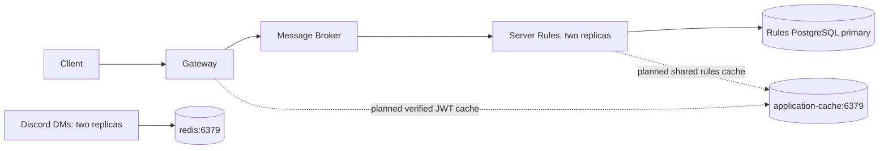

# Lab 5 application cache

## Status and architecture

This branch provisions Redis and supplies environment variables to its intended clients.
The currently selected Gateway and Server Rules images do not implement these clients yet.
No image tags or source submodule pointers are changed by this infrastructure step.



The dotted connections become active after the service implementations are released.
This diagram supplements the existing architecture diagram for the caching work; ETL,
warehouse and replication changes remain with their respective owners.

## Configuration

| Setting | Default | Meaning |
|---|---|---|
| `CACHE_MAXMEMORY` | `128mb` | Redis data memory threshold; not a hard container RAM limit |
| `RULES_CACHE_TTL_SECONDS` | `60` | Planned lifetime of cached rules |
| `AUTH_CACHE_TTL_SECONDS` | `60` | Planned maximum token-cache lifetime; never beyond token expiry |
| `CACHE_REDIS_URL` | `redis://application-cache:6379/0` | Set in Compose for Gateway and both Rules replicas |

Redis has no published host port. It is accessible to containers on the Compose network,
which is treated as trusted, like the existing internal service connections. There is no
persistent volume, RDB snapshot or AOF: recreation starts with an empty cache. PostgreSQL
remains the source of truth and JWTs must be fully verified on authentication cache misses.

The `noeviction` policy prevents memory pressure from silently removing future consistency
metadata alongside cached values. Once the threshold is reached, writes that need more
memory fail; application clients must handle that failure and use their normal source.
TTL expiry still removes expired entries. This policy does not implement Grade 7 sharding.
See the [Redis eviction reference](https://redis.io/docs/latest/develop/reference/eviction/).

There is deliberately no mandatory `depends_on` relationship to the cache. The forthcoming
clients must tolerate startup without Redis, use short connection/command timeouts, fall back
on failures, and recover when Redis returns. A Redis health check diagnoses Redis itself;
it does not prove application caching or safe fallback works.

## Verify this infrastructure

Run from the integration repository with your existing `.env`:

```bash
docker compose config --quiet
docker compose up -d application-cache
docker compose ps application-cache
docker compose exec -T application-cache redis-cli ping
docker compose exec -T application-cache redis-cli CONFIG GET maxmemory maxmemory-policy save appendonly
```

Expect `PONG`, `maxmemory` of `134217728` with the default setting, `noeviction`, an empty
`save` setting, and `appendonly` set to `no`. No application services need to be recreated
just to check the infrastructure.

Check disposable data and expiration using a dedicated diagnostic key:

```bash
docker compose exec -T application-cache redis-cli SET pad17:diagnostic:ttl ready EX 10
docker compose exec -T application-cache redis-cli GET pad17:diagnostic:ttl
docker compose exec -T application-cache redis-cli TTL pad17:diagnostic:ttl
```

The immediate GET should return `ready`; TTL should be positive. Repeat GET after more than
10 seconds and expect an empty result. This proves Redis expiry, not application behavior.
To verify container-network DNS and connectivity using the existing Gateway image:

```bash
docker compose exec -T gateway-service python -c 'import socket; s=socket.create_connection(("application-cache",6379),timeout=2); s.sendall(b"*1\r\n$4\r\nPING\r\n"); print(s.recv(64).decode().strip()); s.close()'
```

Expect `+PONG`. This command requires a running Gateway container.

## Acceptance checks after the service changes

### Prometheus cache monitoring

Prometheus scrapes `gateway-service:8000/metrics` using the `gateway-service` job.
The existing `server-rules-service` job collects rules-cache counters from both replicas.
Deploy cache-enabled images before expecting these metrics; the older Gateway image
returns 404 for `/metrics` and its Prometheus target will be DOWN until upgraded.
This monitoring change does not select or publish new application images.

After updating the configuration, run from this repository:

```bash
docker compose restart prometheus
```

Open `http://localhost:9091/targets` and check that `gateway-service` and both Rules
targets are UP. Then compare these queries before and after repeated authenticated
requests (allow at least one 5-second scrape interval):

```promql
sum(gateway_auth_cache_lookups_total{service="gateway",result="hit"})
sum(gateway_jwt_verifications_total{service="gateway"})
sum(rules_cache_lookups_total{service="server-rules-service",result="hit"})
sum(rules_database_loads_total{service="server-rules-service"})
sum(rules_version_checks_total{service="server-rules-service"})
```

A repeated valid token should add a Gateway cache hit without another full signature
verification. Repeated rules reads should add cache hits without additional full-rule
loads; each rules read still makes a lightweight database version check. The existing
Grafana Prometheus data source can query these counters in Explore; no new dashboard
panels are provisioned by this change.

### Application acceptance checks

These are pending; this branch does not claim they pass:

1. Run authenticated `GET /rules` twice through `http://localhost:8090` in Postman.
   Demonstrate a rules miss followed by a hit and no second database read. A `200` alone
   is insufficient; use application counters and repository-call tests.
2. Update rules with `PUT /rules`, then read through both application replicas. Verify fresh
   rules, including a controlled test where an old read overlaps the write.
3. Reuse a valid JWT and demonstrate an authentication-cache hit without repeated signature
   verification. Invalid and expired tokens must still fail; configuration changes must
   separate verification results. Never log the token or put it in a readable cache key.
4. Let entries expire and demonstrate a new miss. Token expiry must be checked independently
   of Redis TTL. Preserve any time-sensitive claim checks on cache hits.
5. Stop Redis with `docker compose stop application-cache`, repeat requests, and verify
   database reads and normal JWT verification still work. Restart with
   `docker compose start application-cache` and verify caching recovers.

Add the exact application metrics and Postman assertions when the corresponding services
implement them. Redis `INFO stats` is useful for diagnostics but includes all clients and
metadata operations; it cannot alone prove how many database reads were avoided.
