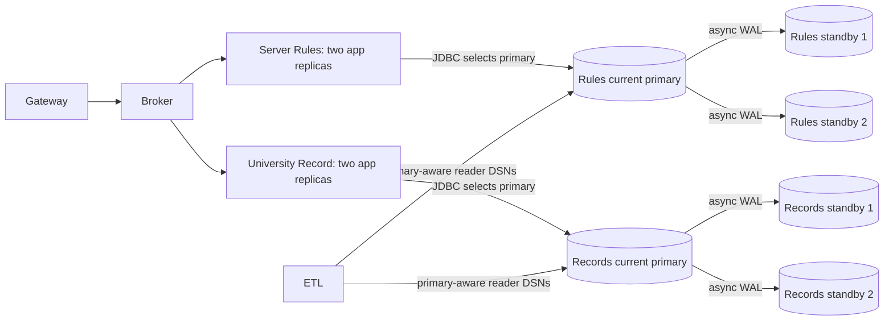

# Private database replication in CPR

## Scope and status

`docker-compose.replication.yml` is an explicit overlay for Server Rules and University
Record. Each database gets one initial primary and two asynchronous physical standbys.
It uses the published `postgres:18` image with public CPR scripts mounted read-only;
teammates do not need access to private repositories or a custom database image.

The application images remain published images selected by `.env`. Both application
replicas, real Session validation (`SESSION_CLIENT=grpc`), Broker, Discovery, and shared
Redis settings are retained. Only the application's JDBC URL changes. No shared submodule
references, published tags, other owners' database clusters, or analytics extraction logic
are changed here. Use the cache-enabled Rules image for the cache part of the demo.

Shell syntax and merged Compose configuration can be validated without deployment.
The private-service failover demonstrations passed separately. The shared-stack rollout,
backup/restore rehearsal, and ETL failover checks below still need to be run against the
images and data selected for the presentation. A readable dump archive alone is not a
successful restore rehearsal.



## Configure and prepare existing data

Prerequisites: Bash 3.2+, jq, Docker Compose v2+, the currently running original PG18
primaries, and working source-reader credentials from the analytics setup. Perform
enablement between game sessions: it briefly stops/recreates the selected service's app
containers and restarts its primary. Keep the existing Compose project name and `.env`.
Do not use `down -v`, rename primary volumes, or import an empty database over existing data.

Add the following settings to your existing `.env` using `.env.example` as the template:

- `SERVER_RULES_REPLICATION_PASSWORD` and `UNIVERSITY_RECORD_REPLICATION_PASSWORD`: separate
  replication credentials; existing database owner passwords must stay unchanged.
- `ANALYTICS_RULES_HA_DSN` and `ANALYTICS_RECORD_HA_DSN`: the three-host, primary-only libpq
  DSNs, with your actual `analytics_reader` credentials. Preserve the original non-HA DSNs.
  Percent-encode reserved characters in passwords. These DSNs must be supported and tested
  by the deployed ETL image; the overlay sets them for scheduler and one-off ETL jobs.

From CPR, validate the overlay without starting anything:

```bash
docker compose -f docker-compose.yml -f docker-compose.replication.yml config --quiet
```

Back up and prepare each original primary:

```bash
bash infrastructure/replication/cluster.sh rules prepare
bash infrastructure/replication/cluster.sh record prepare
```

`prepare` requires PostgreSQL 18 and the expected `/var/lib/postgresql/18/docker` data
directory. It saves a custom-format database dump and roles under ignored, private
`infrastructure/backups/<project>-<cluster>-<timestamp>-<pid>/`, checks the archive with
`pg_restore --list`, then provisions the replication role and HBA rule idempotently.
It records the primary volume name and database system identifier in `.replication-state`.
It does not restart PostgreSQL or change application records. Backup files contain private
data and role password hashes; keep them outside Git and retain a separate safe copy.

The preparation procedure reads existing data in place; **there is no volume migration**
for this PG18 layout. If the layout/version differs, the script refuses to proceed and a
separate migration is needed. If a backup command fails, investigate the partial backup;
no successful preparation receipt is written. Do not treat a receipt as a permanent backup.

Before enablement, add this to the deployment's `.env` so future plain Compose commands
continue using the guarded entrypoint:

```dotenv
COMPOSE_FILE=docker-compose.yml:docker-compose.replication.yml
```

Keep this setting once enabled, including after failover. Dropping the overlay can bypass
the startup guard by recreating a node with the unmodified stock entrypoint. Docker restart
of an existing fenced container retains the guard; deliberate configuration changes can
defeat it. This is single-host operator fencing, not distributed leader election.

Recreate the existing scheduler with the HA reader DSNs, validate a normal ETL run using
the team's analytics procedure, then enable one database cluster at a time:

```bash
docker compose up -d --no-deps analytics-scheduler
bash infrastructure/replication/cluster.sh rules enable
bash infrastructure/replication/cluster.sh rules status
bash infrastructure/replication/cluster.sh record enable
bash infrastructure/replication/cluster.sh record status
```

`enable` refuses an existing primary volume without matching preparation metadata and
retained backup files. It checks the system identifier directly, refuses a fenced/rebuilt
original primary, starts the primary first, then the standbys, and recreates only that
service's app replicas. If it fails after stopping the app, inspect status before resuming.
Do not automatically restore over a live database as a workaround.

The original primary volumes stay `server-rules-db-data` and `university-record-db-data`.
Only four new standby volumes are added. Nodes have no published database ports. Fresh
empty installations can initialize through the overlay directly, but do not use that as a
reset workflow for existing data. Newly initialized schemas and analytics-reader grants
must be set up using their owning services and the existing analytics instructions.

## Manual failover and rejoining

Examples for the initial primary names:

```bash
bash infrastructure/replication/cluster.sh rules failover server-rules-db
bash infrastructure/replication/cluster.sh rules status
bash infrastructure/replication/cluster.sh rules rejoin server-rules-db

bash infrastructure/replication/cluster.sh record failover university-record-db
bash infrastructure/replication/cluster.sh record status
bash infrastructure/replication/cluster.sh record rejoin university-record-db
```

Use the current primary's actual name on later failovers. Optional `--candidate NODE`
is accepted only when the candidate is available and not behind another available standby.
The operator stops the old primary, verifies restart is disabled, writes a persistent
`FENCED` marker, waits for available standbys to replay received durable WAL, checks system
identifiers and promotes the most advanced available candidate. A paused/stuck replay
times out without promotion. SQL/Compose calls have bounded timeouts and local commands
are serialized with a per-project/per-cluster directory lock.

This retains the private services' tested failover algorithm. It does not explicitly
validate timeline ancestry, compare unavailable nodes, or guarantee preservation of WAL
that no available standby received. In-flight requests can fail and require retrying after
recovery. Asynchronous replication can lose recently acknowledged writes. Do not describe
this setup as automatic failover or zero-data-loss replication.

After promotion, JDBC connects only to a writable primary. Rules promotion also rotates
`rules_revision`, invalidating old versioned Redis keys without flushing Gateway tokens.
The other reachable standby is repointed to the promoted node. If it cannot follow that
history, rebuild it with `rejoin` too. Rejoining preserves prior PGDATA under a timestamped
name, takes a fresh base backup, and clears fencing only after success. It refuses to rebuild
the current reachable primary. Preserved directories consume disk; none are auto-deleted.

Analytics must also reconnect to the current primary. The script checks desired HA DSNs
and, if the scheduler is running, checks that its deployed DSN matches before enable/failover.
Do not recreate analytics after failover using dependencies that demand the stopped original
primary; use `--no-deps` only after checking the promoted database and warehouse are healthy.

## Restart after failover

Persist the overlay and use the roles currently stored on disk. Do not blindly start the
old primary or remove its fence. For example, if Rules standby 1 was promoted:

```bash
docker compose up -d --no-deps --wait server-rules-db-standby-1
# Only after successful rejoining of the other nodes:
docker compose up -d --no-deps --wait server-rules-db server-rules-db-standby-2
docker compose up -d --no-deps server-rules-service
```

Use the analogous University Record names for that cluster. Initial Compose dependencies
still describe the original topology, so whole-stack `up` can block on an original primary
that remains fenced. `stop` in the operator script stops only the selected cluster and app;
it keeps all volumes. Never fall back to the base-only configuration after promotion.

## Shared-stack acceptance checks (pending)

1. Verify existing rules, records, assignments and analytics-reader roles remain present
   after preparation/enablement. Restore a backup into a separate disposable database and
   validate it before relying on it for recovery. Check both app replicas are healthy in
   Discovery and Prometheus, and real Session/Broker settings remain effective.
2. Through authenticated Gateway requests, replace/read rules and check cache counters.
   Check the same rules and `rules_revision` on both standbys before proceeding.
3. Create an active session through the real Session workflow, create a record through
   Gateway, assign scopes through the real Session gRPC workflow and read allowed scopes.
   Confirm records and assignment collection tables reach both standbys.
4. Fail over one database at a time. Confirm the old container refuses restart, the existing
   app containers reconnect, Gateway reads still return the replicated data, and new writes
   work. Missing identity/unassigned-player checks must remain enforced for records.
5. Check Rules' revision changed on promotion and no obsolete rules cache entry is used.
   Run analytics against the promoted primary with dedicated reader credentials and verify
   the warehouse reflects a new write. Shared ETL compatibility has not been tested here.
6. Rejoin old nodes, check two `streaming`, `async` standbys per primary and matching data,
   then update the final architecture/demo evidence. Never infer these results from config
   validation or the earlier private-repo demonstrations alone.

References: [PostgreSQL failover](https://www.postgresql.org/docs/18/warm-standby-failover.html),
[libpq multi-host connections](https://www.postgresql.org/docs/18/libpq-connect.html),
[Compose merge semantics](https://docs.docker.com/reference/compose-file/merge/).
