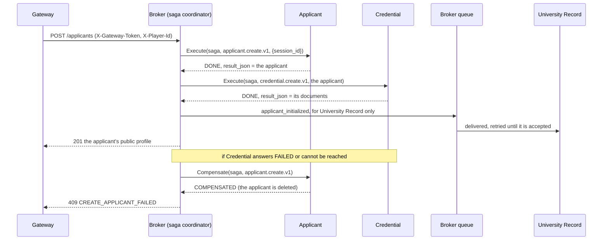

# Long-running saga: create an applicant (Lab 5, Grade 9)

The handout asks for long-running saga transactions with a coordinator in the Gateway or the Message Broker,
instead of two-phase commit. The coordinator is in the **Message Broker** (`saga.py`, next to the two-phase
commit one), and the flow it runs is **create an applicant**: Applicant, then Credential, then University Record.

## Saga or two-phase commit

| | Two-phase commit (Grade 8) | Saga (Grade 9) |
|---|---|---|
| Each step | *prepares*: stored but invisible, then waits for the decision | *executes*: committed in the service's own database at once |
| Between the steps | the prepared changes are held until the coordinator decides | nothing is held: other requests can already read the result |
| When a later step fails | `Rollback` of what was only prepared | `Compensate`: a new transaction that undoes a step that was already committed |
| What a reader can see | never half of a transaction | the applicant can exist for a moment before its documents do (eventual consistency) |
| Contract | `proto/transactions.proto` | [`proto/saga.proto`](../proto/saga.proto) |

Both are on the same internal port 9091 of the service, behind the same `x-transaction-token`.

## The flow



| Step | Service | Operation | Kind | Compensation |
|---|---|---|---|---|
| 1 | Applicant | `applicant.create.v1`, payload `{"session_id": "uuid"}` | compensable | deletes the applicant, with the code of `DELETE /applicants/{id}` |
| 2 | Credential | `credential.create.v1`, payload: Applicant's `result_json` | compensable | deletes the documents, with the code of `DELETE /credentials/{id}` |
| 3 | University Record | `applicant_initialized` event, queued for that service only | retriable | none: the queue retries it and keeps dead letters |

University Record is the last step on purpose. It has no `DELETE` endpoint, so a step there could not be
compensated; as the final step it never has to be, and the event it already handles idempotently is delivered by
the Broker's durable queue until it is accepted. A saga is complete once every compensable step is done and the
event is queued.

No step publishes an event of its own: the coordinator carries the data, so Credential and University Record do
not build their side a second time from `applicant_initialized`.

## The contract

[`proto/saga.proto`](../proto/saga.proto), a copy of the Message Broker's: `package pad.saga.v1`, service
`SagaParticipant` with two calls. Every answer is a `SagaStepReply { saga_id, state, result_json }`.

| Call | What the participant does | Answers |
|---|---|---|
| `Execute(saga_id, operation, payload_json)` | Does the step and commits it with its own saga row in one local transaction. No event is published. | `DONE` with the result, `FAILED` with `{"reason": "..."}` (nothing changed), `COMPENSATED` if the saga was already compensated, `UNKNOWN` for an operation it does not have |
| `Compensate(saga_id, operation)` | Undoes a `DONE` step in one local transaction. If the step never ran or failed, it leaves a *tombstone*. | `COMPENSATED`, always |

What a participant promises, and how Applicant and Credential do it (table `saga_steps`, Flyway V3, primary key
`(saga_id, operation)`):

| Promise | How |
|---|---|
| The state survives a restart | the step and its `saga_steps` row are written in the same database transaction |
| Repeating a call gives the same answer | Execute returns the stored `DONE` / `FAILED`; Compensate is idempotent |
| The same saga with other data is rejected | a SHA-256 of the operation and the payload, keys sorted: `FAILED_PRECONDITION` |
| A late Execute cannot revive a compensated saga | a Compensate that arrives first leaves a tombstone, and the Execute answers `COMPENSATED` |
| A refusal is an answer, not an error | an invalid payload or a shift that is not running is `FAILED` with a reason, and it is remembered |
| Infrastructure failures are visible | any other failure is a gRPC `INTERNAL`, so the coordinator tries again or compensates |

## The coordinator

In the Message Broker (`saga.py`, `saga_client.py`, `create_applicant_saga.py`, tables `sagas` and `saga_steps`
in the same SQLite file as the queue):

- Steps run in order. A `FAILED` answer compensates at once. A call that cannot be completed is tried 3 times,
  0.2 s apart, and then the saga is compensated.
- Compensation goes **in reverse order** and stops at the first step that does not confirm. A step whose outcome is
  unknown (the call went out and the answer was lost) is compensated too: if it never ran, the participant leaves
  the tombstone.
- The 2-second recovery thread that already finishes two-phase commit decisions also resumes sagas after a restart:
  a saga that stopped before every compensable step was `DONE` is compensated, and one that only has the queued
  event left is finished.
- The same `saga_id` never repeats a finished step, and it returns the stored outcome.

## From the Gateway

With `BROKER_CREATE_APPLICANT_SAGA_ENABLED=true` the Broker runs `POST /forward/applicant-service/applicants` as
this saga instead of forwarding it. The Gateway sends `X-Gateway-Token` (its `BROKER_GATEWAY_TOKEN`, shared with
the Broker, the same one end shift uses) and the authenticated `X-Player-Id`; a request without them is `401`.
The client's URL and body do not change: `POST /applicants` with `{"session_id": "..."}`.

| Answer | When |
|---|---|
| `201` and the applicant's public profile, header `X-Saga-Id` | the saga completed. The profile is read back from Applicant, so `deception` is never sent. |
| `404 SESSION_NOT_FOUND`, `409 SESSION_NOT_ACTIVE`, `503 SESSION_SERVICE_UNAVAILABLE` | the Applicant refused the first step; the same answer as without the saga |
| `409 CREATE_APPLICANT_FAILED`, with the participant's reason | a later step refused, and what was done is undone |
| `503 CREATE_APPLICANT_PENDING` | the saga did not finish within the request's 4.5 s, or a compensation could not be confirmed yet; retry with the same `Idempotency-Key` |
| `409 IDEMPOTENCY_KEY_REUSED` | the key was used with another body |
| `502 INVALID_PARTICIPANT_RESPONSE` | the Applicant's result has no `applicant_id` |

`Idempotency-Key` is optional: with it, the saga id is derived from the player and the key, so a retry resumes the
same saga; without it, every request is a new saga. `GET /sagas/{saga_id}` (internal) shows the state of each
step, never their results.

When the Broker starts with the flag on it needs `BROKER_TRANSACTION_ADDRESSES` for `applicant-service` and
`credential-service` and a valid `BROKER_GATEWAY_TOKEN`. In the CPR the participants' tokens are the same
`APPLICANT_SERVICE_TRANSACTION_TOKEN` and `CREDENTIAL_SERVICE_TRANSACTION_TOKEN` as for two-phase commit; Compose
gives each service its own as `TRANSACTION_TOKEN`, and `.env.example` already lists both addresses.

## Verify

```bash
bash tests/verify-saga-participants.sh
```

It plays the coordinator against real Applicant and Credential containers and PostgreSQL, over gRPC on port 9091:
a call without the token, or with the other service's, is `UNAUTHENTICATED`; Execute makes the applicant readable
at once and nothing goes to `two_phase_transactions`; repeating it returns the same result and creates nothing;
another payload for the same saga is `FAILED_PRECONDITION`; the state survives a restart of both services;
Compensate in reverse order leaves no applicant and no documents and the applicant answers 404; compensating
twice is harmless; an Execute after the Compensate creates nothing; a Compensate that comes first leaves a
tombstone; a shift that is not running is `FAILED` with a reason and the refusal is remembered; an unknown
operation is `UNKNOWN`; a saga id of 65 characters is `INVALID_ARGUMENT`.

Unit tests: the Broker (`tests/test_saga.py`, `test_saga_client.py`, `test_saga_routes.py`), Applicant and
Credential (the saga tests next to the two-phase commit ones), the Gateway (`test_gateway_service_mappings.py`).

## Open points

- The Broker's own coordinator (`SagaCoordinator` with `SagaClient`) was also run once against the two containers,
  outside the repository: the happy path, the same saga id again, a refusal at step 1, a refusal at step 2 (the
  applicant it created was deleted), a late Execute after the compensation, and Credential stopped in the middle
  (the saga waited in `COMPENSATING`, then finished both compensations after Credential came back). The route
  through the Gateway was run on 25 Nov on a full Compose stack (Broker, Gateway, Applicant and Credential built
  from their `dev` branches): the saga completed with the credentials readable at the `201` and the record then
  in University Record's database, and with Credential stopped it was compensated and the same `Idempotency-Key`
  then answered `409`.
- That University Record accepts the same `applicant_initialized` event twice without a second record is taken from
  its Postman collection ("same event again, still 200"); it was not run for this page.
- CPR passes the participant addresses and tokens, and the pinned images have the saga (Applicant and Credential
  4.2.0, Broker 0.2.0, Gateway 0.6.0). It stays off until `CREATE_APPLICANT_SAGA_ENABLED=true` is set with the tokens.
- The Broker is a single process on SQLite, so the saga state is on one node, like the two-phase commit state.
- A request without `Idempotency-Key` that got `503` and is sent again creates a second applicant.
- The two-phase commit participants stay in the services, but the Broker's "create an applicant" workflow for
  them is not wired: for this flow the saga is the one that runs.
