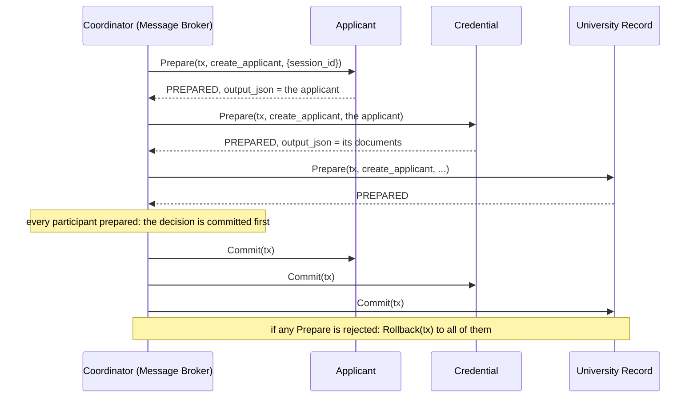

# Two-phase commit participants (Lab 5, Grade 8)

The handout asks for two-phase commit in functionality that changes two or more databases. The team agreed on
the shape on 22 Nov: a coordinator in the Message Broker, and in every service that owns a database the workflow
writes to, a **participant** with four calls. This page is the contract and what Applicant and Credential
(4.2.0) do with it. The coordinator is not described here.



## The contract

[`proto/two_phase_commit.proto`](../proto/two_phase_commit.proto): `package twopc`, service `TwoPhaseParticipant`.
Each service copies it and sets its own `java_package`; the package name stays `twopc` because it is part of the
service name on the wire. The coordinator reaches a participant through Service Discovery, on the `grpc_port` the
instance registered.

| Call | What the participant does |
|---|---|
| `Prepare(transaction_id, operation, payload_json)` | Validates the request and durably stores the changes **without making them visible**. Answers `OUTCOME_PREPARED`, or `OUTCOME_REJECTED` with a reason. `output_json` carries what the next participant needs. |
| `Commit(transaction_id)` | Applies what was prepared. Answers `STATE_COMMITTED`, also when it already was. |
| `Rollback(transaction_id)` | Discards it. Answers `STATE_ABORTED`, also when it already was or was never seen. |
| `Status(transaction_id)` | `STATE_UNKNOWN`, `STATE_PREPARED`, `STATE_COMMITTED` or `STATE_ABORTED`, for the coordinator's recovery. |

What the team agreed a participant promises, and how the two services do it:

| Promise | Applicant and Credential |
|---|---|
| The state survives a restart | `two_phase_transactions` row, written in the same database transaction as the validation |
| Repeating a call gives the same answer | Prepare returns the stored answer, Commit and Rollback return the final state |
| The same id with other data is rejected | a SHA-256 of the operation and the payload, keys sorted |
| No contradictory decisions | `FAILED_PRECONDITION` for Commit after Rollback, Rollback after Commit, and Commit of a transaction never prepared |
| A late Prepare cannot revive a rolled back transaction | a Rollback that arrives first leaves a tombstone, and the Prepare is rejected |
| No rollback on a timeout | there is no timeout logic: only the coordinator decides |

## `create_applicant`

The workflow that touches the three applicant-side databases. Applicant goes first, because it decides the
applicant (id, deception, the whole claim); Credential forges the documents of that person, lying the way
Applicant decided. Today the same result comes from events (`applicant_initialized` and its peers); with 2PC the
coordinator carries the data in `output_json`, so **no event is published** for a transaction.

Prepare puts the changes in `two_phase_transactions`, not in `applicants` / `credentials`, so a rolled back
transaction leaves nothing behind and nobody can read half a transaction. Commit copies what was prepared into the
real tables. The DTOs are in each service's README (*Incoming gRPC - two-phase commit*).

## Verify

```bash
bash tests/verify-two-phase-participants.sh
```

It plays the coordinator against real Applicant and Credential containers and PostgreSQL, over gRPC, and checks:
both prepare and nothing is visible; the prepared state survives a restart of both services; Commit makes exactly
the prepared applicant and documents visible, and repeating it changes nothing; Rollback after Commit is refused;
a rolled back transaction creates nothing and a later Commit is refused; a Rollback that arrives first refuses the
late Prepare; an unknown transaction is `STATE_UNKNOWN`; the same id with other data is rejected.

Unit tests are in each service (`TwoPhaseParticipantTest`, `TwoPhaseGrpcServiceTest`).
Metrics: `pad_twopc_decisions_total{operation,phase,result}` at `/actuator/prometheus`.

## Open points

- The `.proto` here follows the contract agreed in the chat. If the coordinator needs a change (for example the
  extra `output_json` it already adds to Prepare is in; field names or the transport are not final), the
  participants change with it: the logic is in `twopc/TwoPhaseParticipant`, the wire format only in
  `twopc/TwoPhaseGrpcService`.
- Only `create_applicant` is implemented. The other workflows proposed for the grade (end shift and award
  progression, start a shift, submit a verdict) belong to the services that own them.
