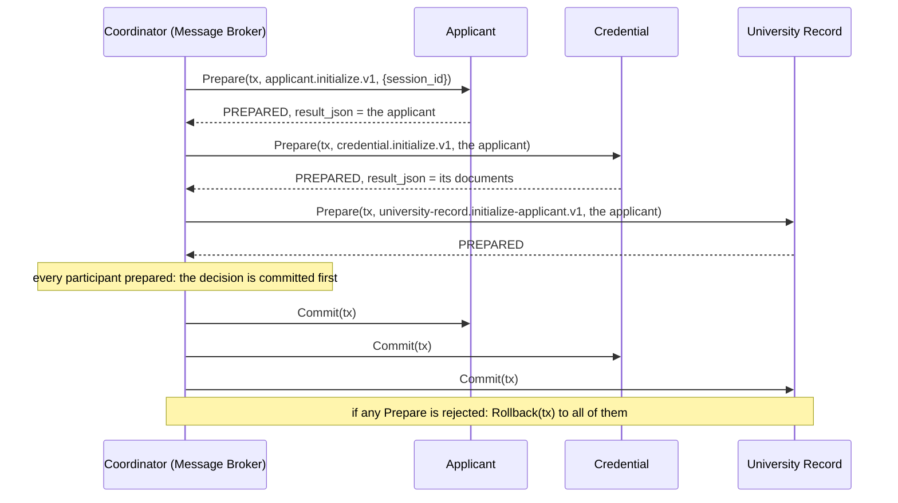

# Two-phase commit participants (Lab 5, Grade 8)

The handout asks for two-phase commit in functionality that changes two or more databases. The team agreed on
the shape on 22 Nov: a coordinator in the Message Broker, and in every service that owns a database the workflow
writes to, a **participant** with four calls. The contract is the Message Broker's `proto/transactions.proto`
(Janeta, 23 Nov); this page is what Applicant and Credential (4.2.0) do with it. The coordinator is described in
the Message Broker's README.



## The contract

[`proto/transactions.proto`](../proto/transactions.proto), a copy of the Message Broker's: `package
pad.transactions.v1`, service `TransactionParticipant`. Each service copies it and adds its own `java_*` options.
The coordinator calls a participant at its fixed address - `applicant-service:9091`, `credential-service:9091` -
a port apart from the `grpc_port` the services call each other on, and sends the participant's token in the
`x-transaction-token` metadata. In the CPR the tokens are `APPLICANT_TRANSACTION_TOKEN` and
`CREDENTIAL_TRANSACTION_TOKEN`, and a service receives its own as `TRANSACTION_TOKEN` (at least 32 printable
characters; without it the port is not opened). A call without the token, or with another one, is `UNAUTHENTICATED`.

Every answer is a `TransactionReply { transaction_id, state, result_json }`; the coordinator accepts a Prepare only
when `state` is `PREPARED`, and a decision only when it is `COMMITTED` / `ABORTED` as asked.

| Call | What the participant does |
|---|---|
| `Prepare(transaction_id, operation, payload_json)` | Validates the request and durably stores the changes **without making them visible**. Answers `PREPARED` with what the next participant needs in `result_json`, or `ABORTED` with `{"reason": "..."}`. |
| `Commit(transaction_id)` | Applies what was prepared. Answers `COMMITTED`, also when it already was. |
| `Rollback(transaction_id)` | Discards it. Answers `ABORTED`, also when it already was or was never seen. |
| `Status(transaction_id)` | `UNKNOWN`, `PREPARED`, `COMMITTED` or `ABORTED`, for the coordinator's recovery. |

What the team agreed a participant promises, and how the two services do it:

| Promise | Applicant and Credential |
|---|---|
| The state survives a restart | `two_phase_transactions` row, written in the same database transaction as the validation |
| Repeating a call gives the same answer | Prepare returns the stored answer, Commit and Rollback return the final state |
| The same id with other data is rejected | a SHA-256 of the operation and the payload, keys sorted |
| No contradictory decisions | `FAILED_PRECONDITION` for Commit after Rollback, Rollback after Commit, and Commit of a transaction never prepared |
| A late Prepare cannot revive a rolled back transaction | a Rollback that arrives first leaves a tombstone, and the Prepare is rejected |
| No rollback on a timeout | there is no timeout logic: only the coordinator decides |

## Create an applicant

Operations: `applicant.initialize.v1` (Applicant, payload `{"session_id": "uuid"}`) and `credential.initialize.v1`
(Credential, payload: Applicant's `result_json`). The workflow that touches the three applicant-side databases. Applicant goes first, because it decides the
applicant (id, deception, the whole claim); Credential forges the documents of that person, lying the way
Applicant decided. Today the same result comes from events (`applicant_initialized` and its peers); with 2PC the
coordinator carries the data in `result_json`, so **no event is published** for a transaction.

Prepare puts the changes in `two_phase_transactions`, not in `applicants` / `credentials`, so a rolled back
transaction leaves nothing behind and nobody can read half a transaction. Commit copies what was prepared into the
real tables. The DTOs are in each service's README (*Incoming gRPC - two-phase commit*).

## Verify

```bash
bash tests/verify-two-phase-participants.sh
```

It plays the coordinator against real Applicant and Credential containers and PostgreSQL, over gRPC on port 9091
with the tokens, and checks: a call without the token, or with the other service's, is `UNAUTHENTICATED`;
both prepare and nothing is visible; the prepared state survives a restart of both services; Commit makes exactly
the prepared applicant and documents visible, and repeating it changes nothing; Rollback after Commit is refused;
a rolled back transaction creates nothing and a later Commit is refused; a Rollback that arrives first refuses the
late Prepare; an unknown transaction is `UNKNOWN`; the same id with other data is `ABORTED`.

Unit tests are in each service (`TwoPhaseParticipantTest`, `TwoPhaseGrpcServiceTest`).
Metrics: `pad_twopc_decisions_total{operation,phase,result}` at `/actuator/prometheus`.

## Open points

- The Message Broker does not start "create an applicant" yet (its workflow today is end shift), so the live check
  above plays the coordinator with `grpcurl`. The Broker's own coordinator and gRPC client (`two_phase_commit.py`,
  `transaction_client.py`) were also run once against the two containers, outside the repository: a commit of
  Applicant then Credential, the same transaction id again, an abort because Credential could not prepare and one
  because Applicant could not - the rows were as expected each time.
- CPR Compose has the end-shift Player/Session wiring and the University Record participant address/token
  wiring. Applicant/Credential participant settings remain with their owner. The end-shift and University
  Record toggles stay off by default; enable each only when its matching workflow, images and tokens are ready.
- Only "create an applicant" is implemented. The other workflows proposed for the grade (end shift and award
  progression, start a shift, submit a verdict) belong to the services that own them.
